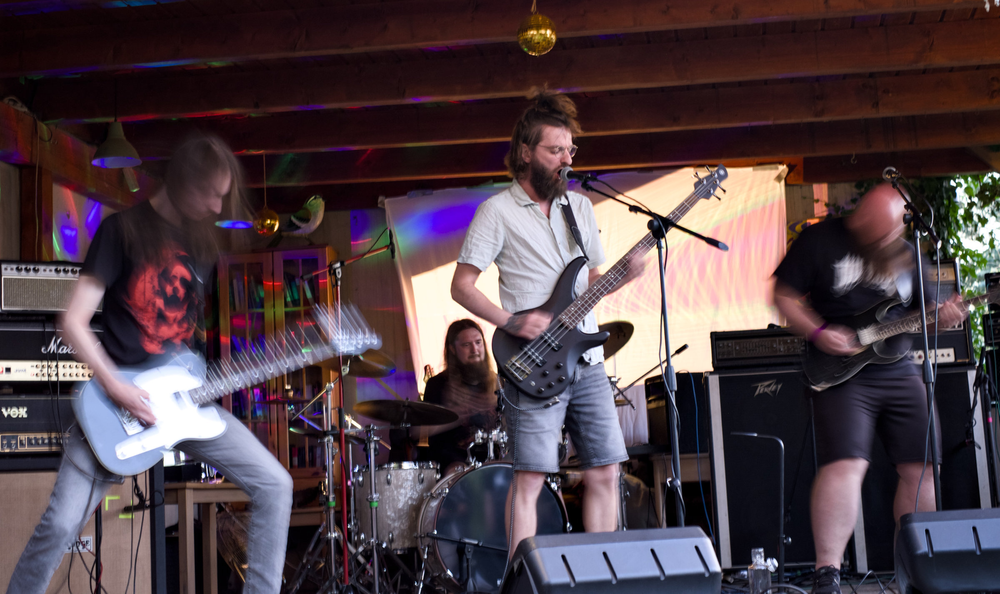
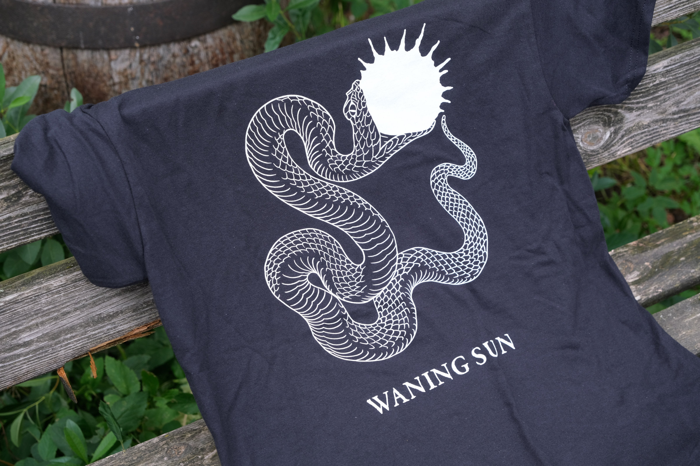

I missed playing noisy and epic music. So, roughly two years ago I joined a new band project: Waning Sun – my first (post-)metal project! And we played our first gig last weekend at the lovely Funkenflug Festival (in Funkenhagen, Brandenburg). We had a blast!

The talented [Nora Uhl](https://norauhl.myportfolio.com/) designed our band logo, and made an awesome shirt that we’re now selling.

Looking forward to future endeavors and gigs with this talented group of people.

If you want to follow along, you can find us on Instagram: [@waningsun_band](https://www.instagram.com/waningsun_band/)
