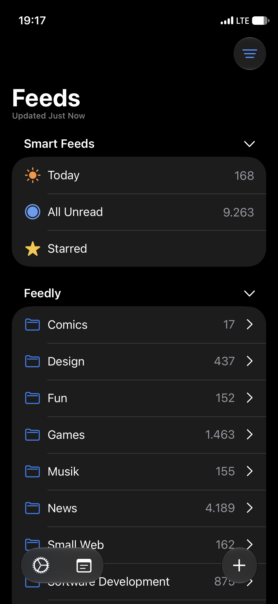
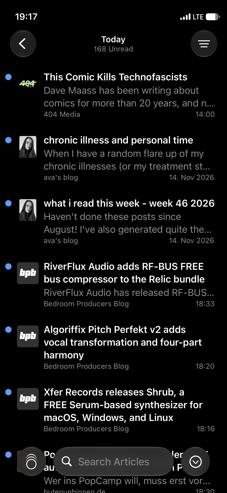
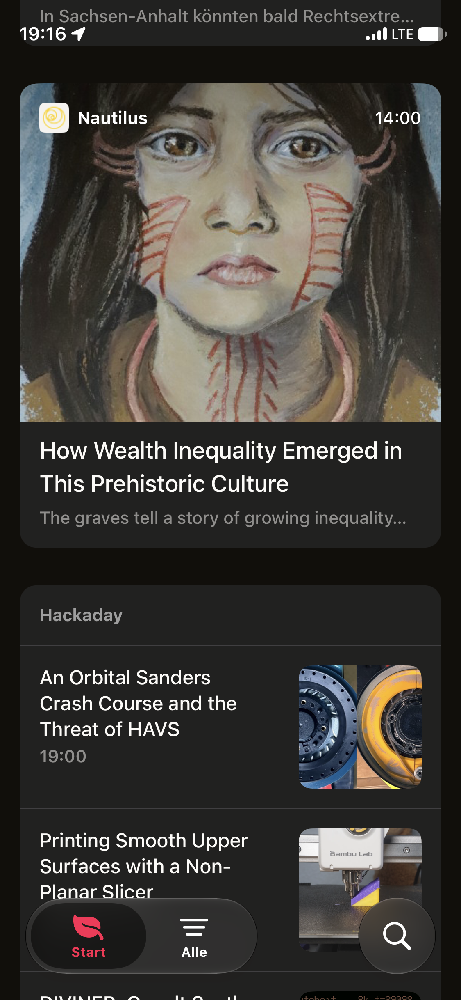
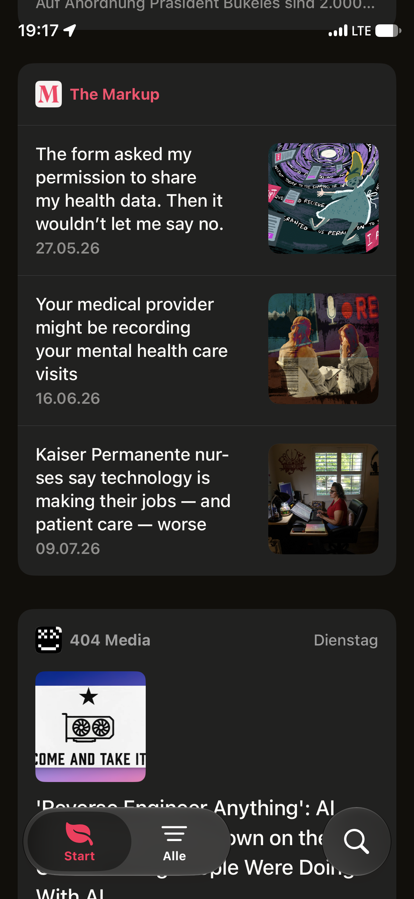
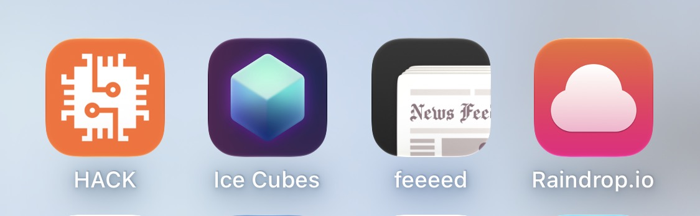

I’ve been using [NetNewsWire](https://netnewswire.com/) as a (RSS) feed reader on my phone for a long time. However, I didn’t really manage to get into a habit of opening it regularly. Instead, I’ve been wasting time with silly sites like Reddit that are becoming increasingly user hostile and stressful to interact with.

Today, I was wondering why I’m not reading my feeds more (because I do like to stay somewhat up-to-date on news and follow my favorite creators that way), and I figured that I’m missing something simple: excitement. NetNewsWire delivers a very plain list experience – no algorithm, no random recommendations, but also no article images or other forms of excitement!

As you can see, NetNewsWire is great at listing and categorizing feeds (and boy, have I categorized everything meticulously). But, I’m seldomly inspired to open the app for actual _reading_. It’s just overwhelming and difficult to manage with so many different feeds! There’s no clear way for me to use the app in a satisfying way.

So, I was looking for alternatives. After repeatedly hearing good things about [Tapestry](https://usetapestry.com/) on Mastodon, I decided to try it out and quickly found it a bit too focused on social media accounts. But, I noticed what I was missing: A more scrollable experience with article’s images to draw me in!

So, I decided to give another reader app a go that I’ve unsuccessfully tried out a few years ago: [feeeed](https://feeeed.nateparrott.com/)!

As you can see, feeeed presents a timeline that’s not strictly chronological but focuses on variety. And it displays just enough preview content (and images!), so that I’m actually intrigued and start reading articles. Articles from sites with a lot of new or unread-by-me content are sometimes nicely grouped together, so I can skim and pick one or two of their articles.

This concept works really well for me. Scrolling through my feed is fun, and I can trust that there’s no random content pushed in there without my agency or knowledge. A funny side effect was the realization that I immediately started looking for a comment section after having read or skimmed an article – fortunately, to no avail! If I want to share or discuss something, I can just do that mindfully on Mastodon or even reallife!

So, thank you for creating feeeed and giving it away for free, dear [Nate Parrott](https://nateparrott.com/)! Hopefully, it keeps me hooked enough to properly quit Reddit. 🤞

